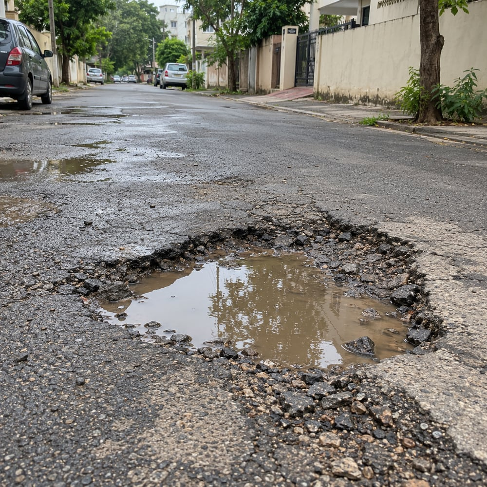
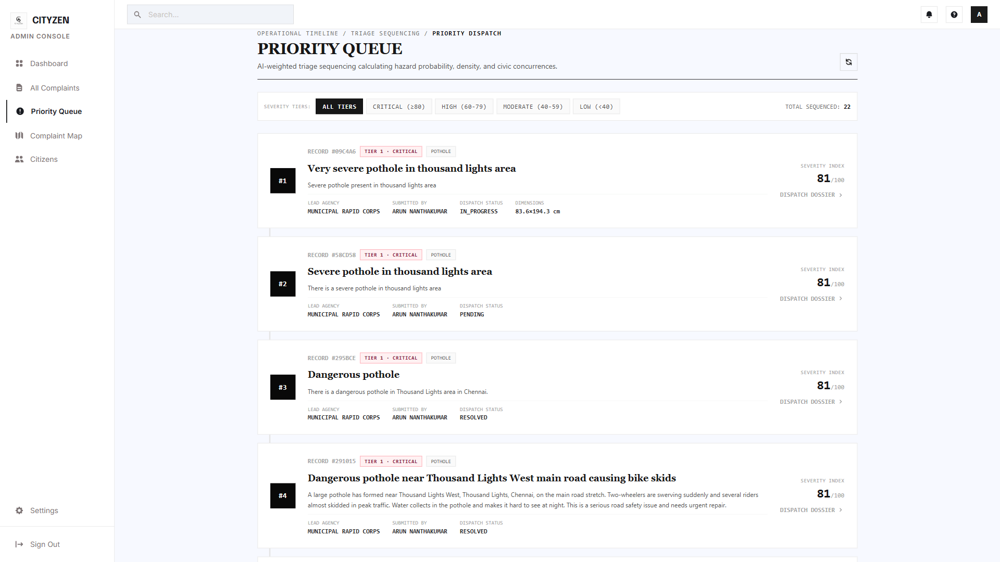
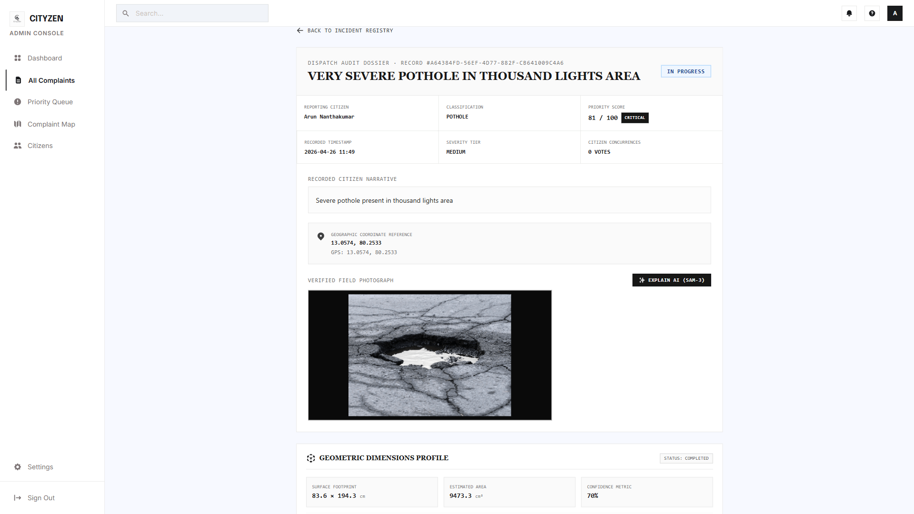
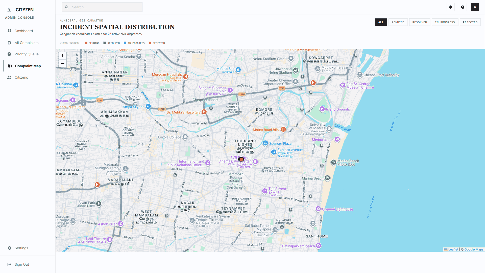
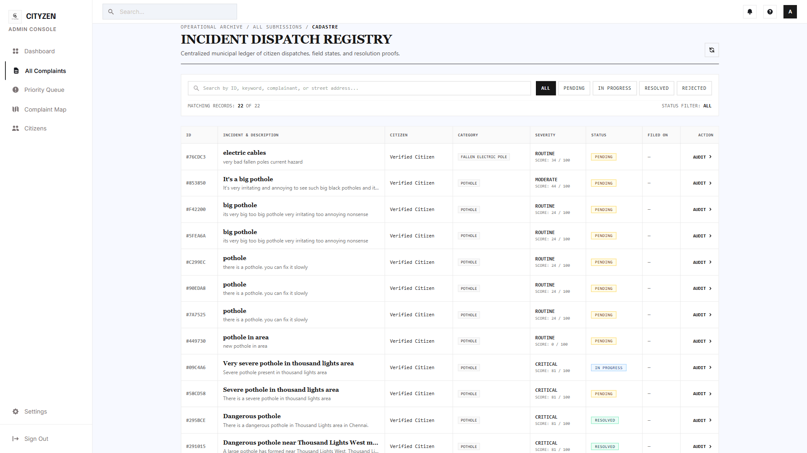

<p align="center">
  
</p>

<h1 align="center">CityZen</h1>

<p align="center">
  An AI-assisted civic engagement platform that lets citizens report
  infrastructure issues with a photo, voice note, or text, and gives
  municipal administrators an evidence-backed, automatically prioritized
  queue to act on them.
</p>

<p align="center">
  
  
  
  
  
</p>

---

## Table of Contents

- [Overview](#overview)
- [Key Features](#key-features)
- [Screenshots](#screenshots)
- [Tech Stack](#tech-stack)
- [System Architecture](#system-architecture)
- [Repository Structure](#repository-structure)
- [Getting Started](#getting-started)
  - [Prerequisites](#prerequisites)
  - [Installation](#installation)
  - [Environment Configuration](#environment-configuration)
  - [Running the Project](#running-the-project)
- [Documentation](#documentation)
- [Testing](#testing)
- [Deployment](#deployment)
- [Project Team](#project-team)
- [Contributing](#contributing)
- [License](#license)

---

## Overview

CityZen (backend codename **CivicStack**, web client codename
**UrbanPulse**) is a full-stack civic-complaint management platform built
around one goal: make it easy for a citizen to report a problem — a
pothole, a fallen electric pole, overflowing garbage, waterlogging — and
make it easy for a municipal administrator to know which reports genuinely
need attention first.

Every report is run through a server-side pipeline that:

- validates an attached photo against the declared issue category using an
  AI vision workflow (Roboflow "CityZen SAM3"),
- screens the written description for authenticity and topical relevance
  across six languages,
- scores emotional urgency in the citizen's own words,
- scores the location's proximity to critical infrastructure (hospitals,
  fire stations, schools, and more), and
- combines all of that, using a documented **Analytic Hierarchy Process
  (AHP)** weighting scheme, into one priority score an administrator can
  trust and act on.

The project is split into three applications sharing one backend API:

| Application | Stack | Audience |
|---|---|---|
| **Backend API** (`backend/`) | Node.js, Express, Supabase (PostgreSQL) | Serves both clients below |
| **Web client** (`frontend/urbanpulse-web/`) | React 18, Vite, Tailwind CSS | Citizens and administrators (browser) |
| **Mobile client** (`frontend/app/`) | React Native, Expo | Citizens (Android / iOS / web) |

## Key Features

- **Multimodal complaint reporting** — submit an issue with a photo, a
  voice recording (transcribed in the citizen's own language), typed text,
  or any combination.
- **AI image validation** — a Roboflow SAM3-based workflow detects whether
  an uploaded photo actually shows the declared civic issue before the
  report is accepted.
- **Automated, explainable priority scoring** — every priority score is
  backed by a documented AHP derivation (see
  [`docs/ARCHITECTURE.md`](docs/ARCHITECTURE.md#the-priority-engine)), not a
  black box or a hand-picked constant.
- **Multilingual content authenticity screening** — a rule-based check plus
  a multilingual zero-shot NLI model catches spam, gibberish, and
  category/description mismatches in English, Hindi, Tamil, Telugu,
  Kannada, and Malayalam.
- **Duplicate detection and community voting** — reports near an existing
  open complaint of the same category are merged as an upvote instead of
  creating a duplicate entry; guests and authenticated users can both vote.
- **Interactive GIS maps** — Leaflet-based heat maps and marker views of
  complaint density and status for both citizens and administrators.
- **Admin workflow management** — a three-stage resolution pipeline
  (Initial Review → Assessment → Resolution) with officer/contractor
  assignment, cost estimates, and completion evidence.
- **Civic chatbot** — a knowledge-grounded assistant (Groq LPU inference
  over a curated civic-knowledge base) for platform help and civic
  procedure questions.
- **Public transparency dashboard** — aggregate resolution rates, category
  breakdowns, and monthly trends, open to every citizen.
- **Full localization** — English, Hindi, Tamil, Telugu, Kannada, and
  Malayalam across both the web and mobile clients.

## Screenshots

The screenshots below are real captures of the running application (admin
portal). The web and mobile citizen-facing screens follow the same visual
language described in [`docs/ARCHITECTURE.md`](docs/ARCHITECTURE.md).

<table>
  <tr>
    <td align="center" width="50%">
      <br/>
      <sub>AI-ranked priority queue (<code>/admin/priority</code>)</sub>
    </td>
    <td align="center" width="50%">
      <br/>
      <sub>Complaint detail and resolution workflow</sub>
    </td>
  </tr>
  <tr>
    <td align="center" width="50%">
      <br/>
      <sub>Geographic overview of active complaints</sub>
    </td>
    <td align="center" width="50%">
      <br/>
      <sub>Unfiltered, arrival-order complaint registry</sub>
    </td>
  </tr>
</table>

## Tech Stack

| Layer | Technology |
|---|---|
| Backend runtime | Node.js, Express |
| Database | Supabase (managed PostgreSQL) |
| Authentication | JSON Web Tokens (JWT), bcrypt |
| AI — image | Roboflow (SAM3 zero-shot instance segmentation) |
| AI — NLP | Groq LPU inference, Hugging Face zero-shot NLI, DistilBERT |
| AI — speech | Sarvam AI, Wit.ai |
| Media storage | Cloudinary |
| Mapping | Leaflet, Google Places API, OpenStreetMap (Nominatim / Overpass / OSRM) |
| Web client | React 18, Vite, Tailwind CSS, React Router, Chart.js, Framer Motion |
| Mobile client | React Native, Expo, React Navigation, i18next |
| Testing | Jest (backend), Vitest + React Testing Library (web) |

## System Architecture

<p align="center">
  
</p>

A full breakdown of the request flow, the priority-engine math, and every
AI/ML component, along with the complete set of UML and data-flow diagrams,
is in [`docs/ARCHITECTURE.md`](docs/ARCHITECTURE.md).

## Repository Structure

```
CityZen/
├── backend/                        Node.js / Express API and AI service pipeline
│   ├── config/                     Supabase client configuration
│   ├── database/                   Hand-run SQL migration patches (see docs/DATABASE.md)
│   ├── middleware/                 JWT authentication middleware
│   ├── python_services/            Optional Python microservice (DistilBERT emotion model)
│   ├── routes/                     Express route handlers (one file per resource)
│   ├── scripts/                    One-off maintenance/data scripts
│   ├── services/                   Business logic: priority engine, AHP math, AI integrations
│   ├── utils/                      Logger and network/host-resolution helpers
│   ├── server.js                   Express application entry point
│   ├── render.yaml                 Render.com deployment blueprint
│   └── PRIORITY_ENGINE_REPORT.pdf  Generated writeup of the priority engine's AHP derivation
│
├── frontend/
│   ├── app/                        React Native / Expo mobile application
│   │   └── src/
│   │       ├── components/         Reusable UI components
│   │       ├── screens/            Citizen, admin, auth, complaint, and feedback screens
│   │       ├── services/           Device/location/speech/API client services
│   │       ├── i18n/locales/       Translations: en, hi, ta, te, kn, ml
│   │       └── theme/              Shared design tokens
│   │
│   ├── docs/diagrams/              UML and data-flow diagrams (architecture, DFD, sequence, class, use case)
│   │
│   └── urbanpulse-web/             React + Vite web application
│       └── src/
│           ├── pages/              Citizen, admin, and auth pages
│           ├── layouts/            Citizen / admin shell layouts
│           ├── components/         Reusable UI components
│           ├── context/            Authentication context (React Context API)
│           ├── services/           Centralized API client (api.js)
│           ├── i18n/locales/       Web-side translations
│           └── utils/              Priority-score display helpers
│
├── docs/                           Project-level documentation (this folder)
│   ├── API.md                      Full REST API reference
│   ├── ARCHITECTURE.md             System design, data flow, and priority-engine deep dive
│   ├── DATABASE.md                 Schema and migration reference
│   ├── ENVIRONMENT.md              Every environment variable, by application
│   └── screenshots/                Images used in this README
│
├── CONTRIBUTING.md                 Contribution guide and project team
├── LICENSE                         MIT License
├── package.json                    Root npm workspace configuration
└── README.md                       This file
```

## Getting Started

### Prerequisites

| Requirement | Version | Needed for |
|---|---|---|
| Node.js | 18.x or 20.x | Backend and both frontends |
| npm | 9+ | Dependency management |
| A Supabase project | — | Database and auth storage |
| Python | 3.10+ (optional) | Only if running the local DistilBERT emotion microservice |
| Expo Go app or an emulator | — | Only for running the mobile client on a device |

Image validation, voice-to-text, the chatbot, and infrastructure-proximity
scoring additionally require API keys from Roboflow, Sarvam AI / Wit.ai,
Groq, and Google Places respectively — the platform runs and degrades
gracefully without them (see [`docs/ENVIRONMENT.md`](docs/ENVIRONMENT.md)).

### Installation

Clone the repository and install dependencies for each workspace:

```bash
git clone https://github.com/KodeWithKeshav/CityZen.git
cd CityZen

# Backend
cd backend && npm install

# Web client
cd ../frontend/urbanpulse-web && npm install

# Mobile client
cd ../app && npm install
```

### Environment Configuration

**Backend** — create `backend/.env`:

```env
NODE_ENV=development
PORT=3001
JWT_SECRET=replace-with-a-long-random-string

SUPABASE_URL=https://your-project.supabase.co
SUPABASE_ANON_KEY=your-supabase-anon-key

# Optional — enables AI image validation
ROBOFLOW_API_KEY=
ROBOFLOW_WORKSPACE=
ROBOFLOW_WORKFLOW=

# Optional — enables the civic chatbot, voice-to-text, and authenticity screening
GROQ_API_KEY=
SARVAM_API_KEY=
HUGGING_FACE_API_KEY=

# Optional — enables media uploads
CLOUDINARY_CLOUD_NAME=
CLOUDINARY_API_KEY=
CLOUDINARY_API_SECRET=
```

**Web client** — create `frontend/urbanpulse-web/.env` from the provided
template:

```bash
cp frontend/urbanpulse-web/.env.example frontend/urbanpulse-web/.env
```

See [`docs/ENVIRONMENT.md`](docs/ENVIRONMENT.md) for the complete, annotated
list of every variable used across all three applications, including which
ones are strictly required versus optional.

Set up the database schema by following
[`docs/DATABASE.md`](docs/DATABASE.md) — the core tables are created once in
your Supabase project, and a handful of small SQL patches under
`backend/database/` are run afterward to enable optional features
(pothole geometry estimation, multilingual tagging, guest-vote
deduplication).

### Running the Project

From the repository root, using the workspace scripts in the root
`package.json`:

```bash
# Start the backend API (http://localhost:3001)
npm run dev:backend

# Start the web client (http://localhost:5173)
npm run dev:web

# Start the Expo development server for the mobile client
npm run start:mobile
```

Or run each application directly from its own directory:

```bash
cd backend && npm run dev            # nodemon, auto-restarts on change
cd frontend/urbanpulse-web && npm run dev
cd frontend/app && npm start         # then press a / i / w for Android / iOS / web
```

Once the backend is running, visit `http://localhost:3001/health` to
confirm it started correctly.

## Documentation

| Document | Contents |
|---|---|
| [`docs/API.md`](docs/API.md) | Every REST endpoint: method, path, auth requirement, request body, and response shape. |
| [`docs/ARCHITECTURE.md`](docs/ARCHITECTURE.md) | Request flow, the full priority-engine/AHP derivation with all weights, AI/ML component list, and every UML/DFD diagram. |
| [`docs/DATABASE.md`](docs/DATABASE.md) | Table reference and the order to apply the SQL migration patches in. |
| [`docs/ENVIRONMENT.md`](docs/ENVIRONMENT.md) | Every environment variable across backend, web, and mobile, with defaults and required/optional status. |
| [`CONTRIBUTING.md`](CONTRIBUTING.md) | Contribution workflow, code style, and the project team. |

## Testing

**Backend** (Jest):

```bash
cd backend
npm test
```

Covers the pothole geometry math (`services/potholeGeometryMath.test.js`)
and an end-to-end smoke test of the CityZen SAM3 workflow integration
(`services/__tests__/cityzenWorkflow.smoke.test.js`).

**Web client** (Vitest + React Testing Library):

```bash
cd frontend/urbanpulse-web
npm run test
```

Covers the authentication context and the centralized API client.

## Deployment

- **Backend** — configured for [Render](https://render.com) via
  `backend/render.yaml` (see `backend/DEPLOYMENT.md` for the full
  step-by-step guide). Any Node.js host works equally well; the server
  reads its port from `process.env.PORT`.
- **Web client** — a static Vite build (`npm run build` inside
  `frontend/urbanpulse-web`) deployable to Netlify, Vercel, or any static
  host. A `vercel.json` is included for Vercel deployments.
- **Mobile client** — built and distributed via
  [Expo Application Services (EAS)](https://expo.dev/eas); configuration is
  in `frontend/app/eas.json`.

## Project Team

CityZen was designed and built by:

| Name | Roll Number |
|---|---|
| Keshav S | CB.SC.U4CSE23222 |
| Vimal HariHar S K | CB.SC.U4CSE23254 |
| Arun N | CB.SC.U4CSE23406 |
| Kokul M | CB.SC.U4CSE23462 |
| Ravula Akshith | CB.SC.U4CSE23648 |

## Contributing

Contributions are welcome. Please read [`CONTRIBUTING.md`](CONTRIBUTING.md)
for the development workflow, code style conventions, and the pull request
checklist before opening a PR.

## License

This project is licensed under the MIT License — see [`LICENSE`](LICENSE)
for the full text.
