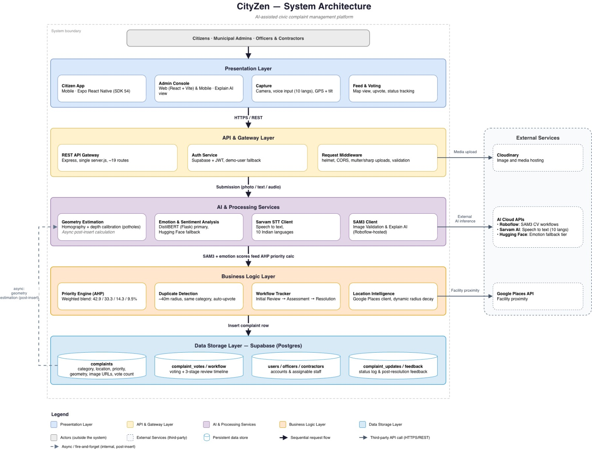
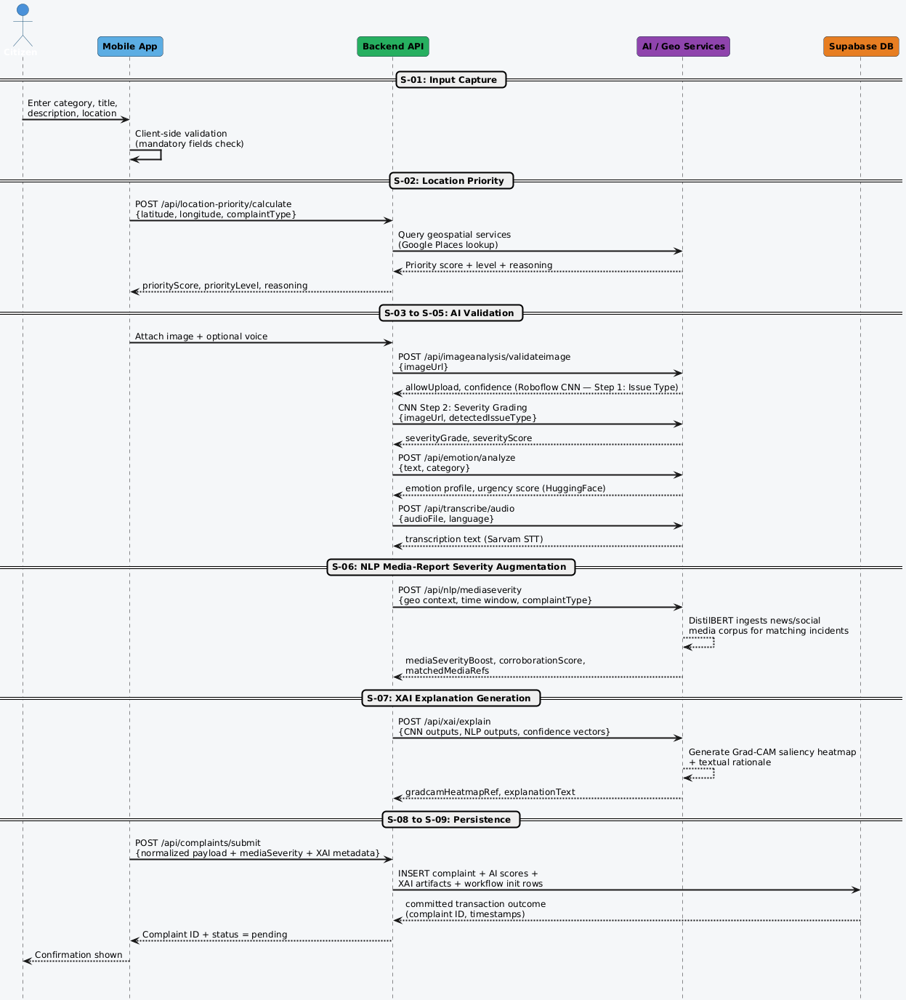
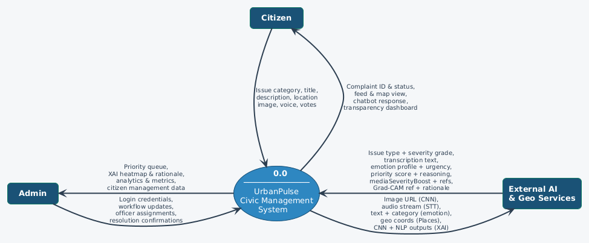
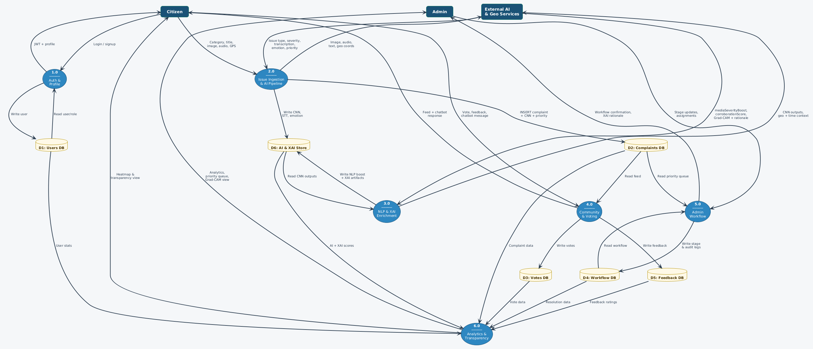
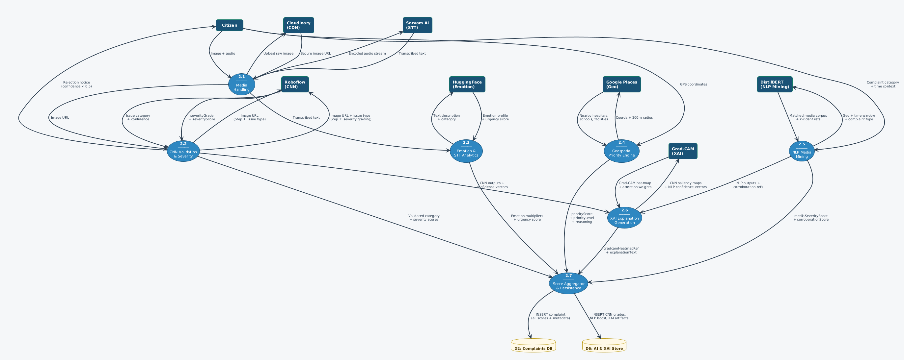
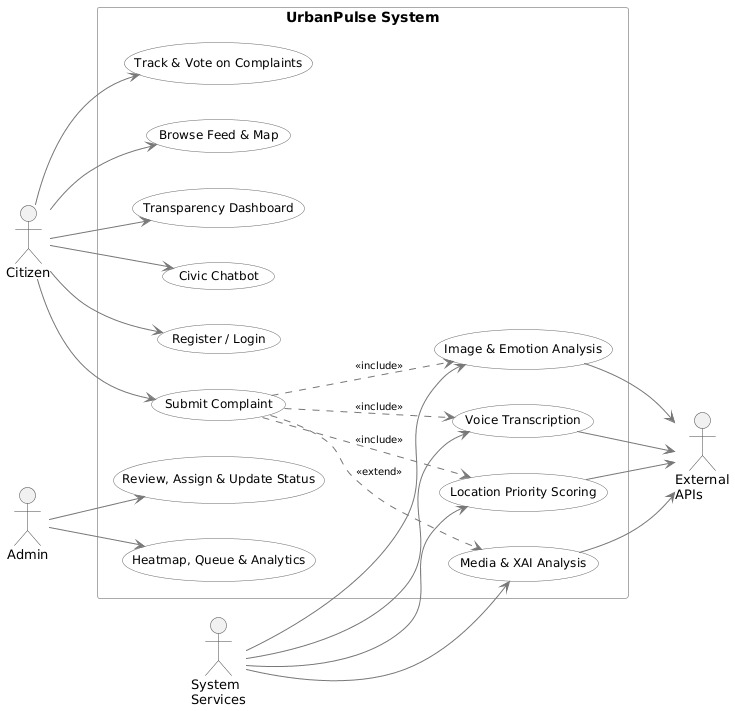
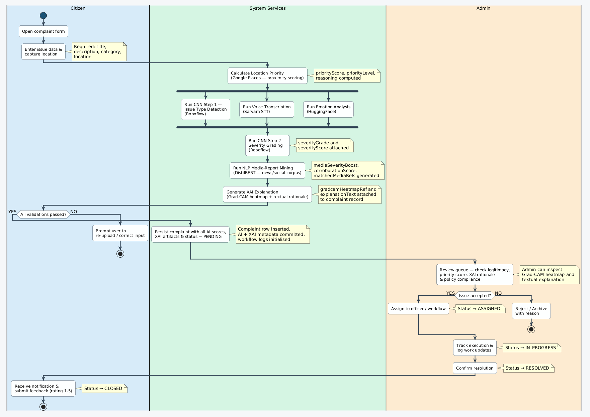
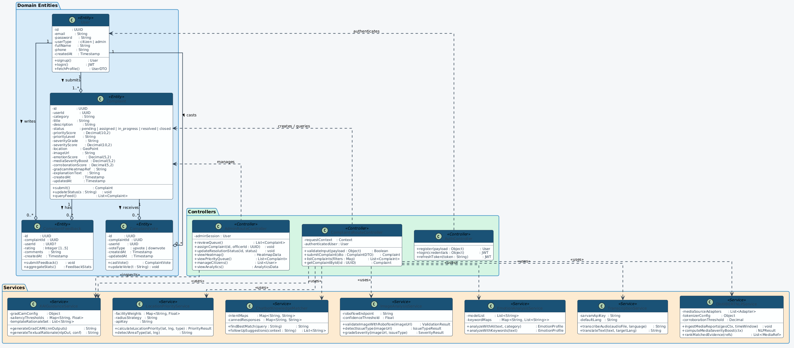

# Architecture

## Overview

CityZen is organized as a monorepo with one backend service and two client
applications:

```
Citizen (Web / Mobile)  --->  Express REST API  --->  Supabase (PostgreSQL)
Admin (Web)              \         |      \
                           \       |       \---> Roboflow (SAM3 image workflow)
                            \      |-------------> Google Places / OpenStreetMap
                             \-----|-------------> Groq / Hugging Face (NLP)
                                   |-------------> Cloudinary (media storage)
                                   |-------------> Sarvam AI / Wit.ai (speech-to-text)
```

The backend is the single source of truth: both client applications call the
same REST API, and all AI/ML scoring (image validation, emotion analysis,
text authenticity, location-priority) happens server-side so the result a
citizen sees and the result an admin relies on for triage are always
identical.

### System Architecture Diagram

<p align="center">
  
</p>

## Request Flow: Submitting a Complaint

1. The citizen selects or is auto-detected into an issue category, optionally
   attaches a photo, writes a description (typed or transcribed from voice),
   and sets a location privacy level.
2. If a photo is attached, the client calls
   `POST /api/image-analysis/validate-image`, which runs Roboflow's
   **"CityZen SAM3" workflow** and returns whether the photo's detected class
   matches the declared category.
3. Before final submission, the client may call
   `POST /api/complaints/analyze-text` to get an early read on emotion and
   text-authenticity scoring, so the UI can warn about a possible
   category/description mismatch before the citizen submits.
4. On `POST /api/complaints/submit`, the backend:
   - Checks for a near-duplicate complaint (same category, within ~40 m) and,
     if found, adds the submitter's vote to the existing complaint instead of
     creating a new one.
   - Re-validates the image result (never trusts the client's own
     `allowUpload` flag).
   - Runs emotion analysis and blended text-authenticity analysis on the
     description.
   - Hard-blocks submission only if the blended authenticity score is low
     enough to be near-certain spam; a moderately low score still succeeds
     but is flagged for admin review.
   - Computes the final priority score (see below) and persists the
     complaint, an initial `complaint_updates` row, and the creator's
     upvote.
   - Fires off (without blocking the response) pothole footprint/depth
     estimation for pothole-category complaints.
5. The response includes the computed priority level, a breakdown of each
   signal's contribution, and category-specific "next steps" text for the
   citizen.

### Sequence Diagram

<p align="center">
  
</p>

### Data Flow Diagrams

<p align="center">
  
</p>
<p align="center">
  
</p>
<p align="center">
  
</p>

### Use Case and Activity Diagrams

<p align="center">
  
</p>
<p align="center">
  
</p>

### Class Diagram

<p align="center">
  
</p>

## The Priority Engine

CityZen's single biggest technical component is its complaint **priority
engine** — a deterministic scoring pipeline that converts a complaint's
image evidence, location, description, and community engagement into one
comparable 0–1 priority score (and a CRITICAL / HIGH / MEDIUM / LOW / MINIMAL
label). Every weight, threshold, and multiplier it uses is defined once, in
`backend/services/priorityConfig.js`, and derived from a documented
**Analytic Hierarchy Process (AHP)** judgment rather than hand-picked as a
bare literal. The AHP math itself (pairwise ratio matrices, the
normalized-column-average weight approximation, and the Consistency Ratio
check) is implemented in `backend/services/ahp.js`, following Saaty's method
(Saaty, 1980/2000).

A full written derivation, including the rationale behind every 1–9
criticality judgment, is generated into `backend/PRIORITY_ENGINE_REPORT.pdf`.

### Top-Level Signal Weights

How much each of the four independent evidence signals contributes to a
complaint's final priority score:

| Signal | Criticality score (1–9) | Weight |
|---|:---:|:---:|
| Image evidence (Roboflow SAM3 detection) | 9 | ~42.9% |
| Infrastructure proximity (nearby critical facilities) | 7 | ~33.3% |
| Text emotion (urgency language in the description) | 3 | ~14.3% |
| Community votes | 2 | ~9.5% |

Image evidence is weighted highest because a vision-model detection is the
hardest signal to fabricate. Community votes are weighted lowest because
upvotes are both the most game-able signal and a lagging one — a hazard
reported minutes ago has had no time to accumulate votes regardless of its
real severity.

### Facility Criticality (Infrastructure Proximity)

Proximity to each facility type is scored with a documented 1–9 judgment of
"if a reported hazard near this facility is not resolved promptly, how much
does that increase risk to life or disruption of essential services?":

| Facility type | Score | Weight |
|---|:---:|:---:|
| Hospital | 9 | ~19.1% |
| Fire station | 9 | ~19.1% |
| Police | 7 | ~14.9% |
| School | 6 | ~12.8% |
| Transit station | 5 | ~10.6% |
| Pharmacy | 5 | ~10.6% |
| Government office | 4 | ~8.5% |
| Bank | 2 | ~4.3% |

Distance itself is scored with a **negative-exponential decay function**
(standard in gravity-based spatial-accessibility research) rather than a
linear ramp, so proximity scoring degrades smoothly instead of hitting an
artificial hard zero at the edge of a search radius.

### Text Emotion Sub-Weights

| Emotion | Score | Weight |
|---|:---:|:---:|
| Urgency | 9 | ~47.4% |
| Concern | 5 | ~26.3% |
| Anger | 3 | ~15.8% |
| Frustration | 2 | ~10.5% |

### Text Authenticity Blend

Two independent authenticity signals are blended: how well the description's
topic matches the declared/detected category, and generic text-quality
heuristics (spam/gibberish detection):

| Signal | Score | Weight |
|---|:---:|:---:|
| Category match | 7 | ~63.6% |
| Text quality | 4 | ~36.4% |

Because the app supports six languages, a second blend combines this
rule-based score with a multilingual zero-shot NLI model
(`ModelAuthenticityService`), weighted 70% model / 30% rule-based — the model
reads semantic content directly in whatever language the text is in, while
the rule-based check remains a zero-latency, zero-dependency floor that is
particularly strong at catching repeated-character spam.

A blended authenticity score below **0.25** hard-blocks submission outright;
a score below **0.45** lets submission succeed but flags the complaint for
admin review.

### Category Urgency Tiers

Every complaint category used anywhere in the codebase (the app's own
8-class image taxonomy plus every legacy category name that appears in
historical data) maps to exactly one of six urgency tiers, each with a
priority multiplier in `[1.10, 1.90]`:

| Tier | Score | Multiplier | Example categories |
|---|:---:|:---:|---|
| Life-threatening | 9 | 1.90 | Fallen electric pole, gas leak, fire hazard, building collapse |
| Public safety | 7 | 1.70 | Broken streetlight, traffic signal fault, road safety |
| Infrastructure integrity | 6 | 1.60 | Pothole, road waterlogging, bridge/structural damage |
| Basic services | 4 | 1.40 | Garbage collection, water supply, power outage |
| Environmental | 3 | 1.30 | Air/noise/water pollution, sewage overflow |
| Civic / administrative | 1 | 1.10 | Park maintenance, documentation requests |

### Priority Levels

A final 0–1 score is classified using equal-interval bands, applied
consistently everywhere a score becomes a label:

| Level | Score range |
|---|---|
| CRITICAL | ≥ 0.80 |
| HIGH | ≥ 0.60 |
| MEDIUM | ≥ 0.40 |
| LOW | ≥ 0.20 |
| MINIMAL | < 0.20 |

These bands are an explicit interim convention. Once enough resolved-complaint
history exists, the project's own report recommends replacing them with
quantile or Jenks natural-breaks thresholds fit to the real score
distribution, rather than evenly-spaced bands.

## AI / ML Components

| Component | Technology | Role |
|---|---|---|
| Image segmentation & validation | Roboflow ("CityZen SAM3" workflow) | Detects whether an uploaded photo shows a recognized civic hazard and whether it matches the declared category. |
| Pothole geometry estimation | Roboflow + custom geometry math (`potholeGeometryMath.js`) | Estimates a pothole's footprint (width/length/area) and depth from a single photo plus device tilt. |
| Emotion / sentiment analysis | Rule-based + DistilBERT (optional Python microservice) | Scores urgency, concern, anger, and frustration in a complaint description. |
| Text authenticity | Rule-based heuristics + multilingual zero-shot NLI (Hugging Face) | Detects spam, gibberish, and category/description mismatches across all six supported languages. |
| Civic chatbot | Keyword-matched knowledge base + Groq LPU inference | Answers citizen questions, grounded in a curated civic-knowledge base rather than an open-ended model response. |
| Speech-to-text | Sarvam AI (primary) / Wit.ai (fallback) | Transcribes voice-reported complaints in the citizen's chosen language. |

## Monorepo Layout

See [README.md — Repository Structure](../README.md#repository-structure)
for the full annotated directory tree.

## Known Legacy Code

`backend/routes/adminEnhanced.js` and `backend/routes/adminSimplified.js`
exist in the repository but are **not mounted** by `backend/server.js` — the
live admin API is served by `backend/routes/admin.js` (which itself mounts
`adminComplaints.js` under `/complaints`) and `backend/routes/adminMinimal.js`
(mounted at `/api/admin-enhanced`, despite the filename). These two orphaned
files are earlier iterations kept in the tree; see `docs/API.md` for the
actual, active endpoint list.
